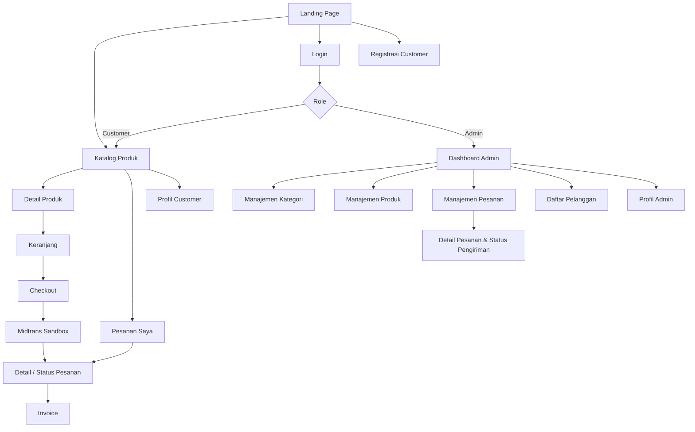
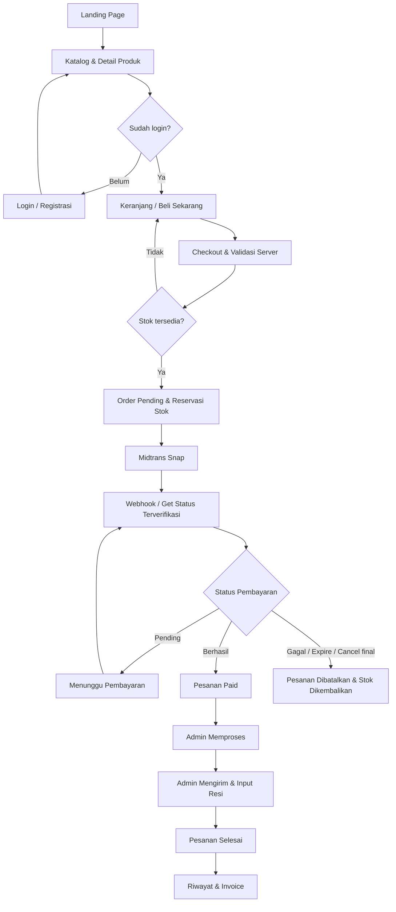
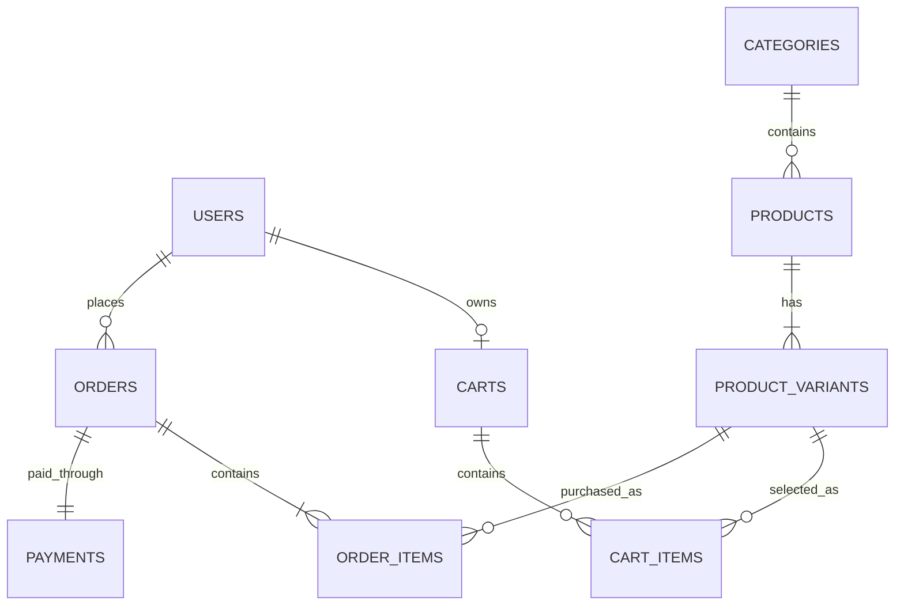

# Product Requirements Document (PRD)

# VELORA — Fashion E-Commerce

**Judul tugas besar:** Rancang Bangun Website E-Commerce Toko Pakaian VELORA Berbasis Laravel dengan Integrasi Midtrans Payment Gateway  
**Versi:** 1.0  
**Platform:** Website responsif  
**Tagline:** Find Your Style, Wear Your Confidence.

---

## 1. Latar Belakang

VELORA merupakan website e-commerce toko pakaian yang menyediakan pengalaman belanja online mulai dari penelusuran produk, pemilihan ukuran dan warna, keranjang belanja, checkout, pembayaran digital, hingga pemantauan pesanan. Konsep pengalaman belanja terinspirasi dari Shopee, tetapi menggunakan identitas, desain, dan implementasi sendiri. VELORA adalah toko tunggal (single seller), bukan marketplace multi-penjual.

Sistem dikembangkan untuk memenuhi Tugas Besar Praktikum Pemrograman E-Commerce Program Studi Sistem Informasi menggunakan Laravel, MySQL, Eloquent ORM, arsitektur MVC, Git/GitHub, serta Midtrans Sandbox.

## 2. Tujuan dan Ruang Lingkup

- Menyediakan halaman utama (landing page) yang dapat diakses tanpa login.
- Memudahkan pelanggan mencari, memilih, dan membeli pakaian secara online.
- Memungkinkan admin mengelola kategori, produk, varian, stok, dan pesanan secara terpusat.
- Mengintegrasikan pembayaran digital melalui Midtrans Sandbox dengan verifikasi server-side.
- Menyediakan riwayat transaksi, invoice, status pembayaran dan pemrosesan pesanan.
- Menjamin pemisahan hak akses Admin dan Customer serta keamanan data transaksi.
- Menghasilkan website responsif yang dapat didemonstrasikan dan diuji sesuai rubrik tugas besar.

Di luar cakupan versi awal: multi-seller, dompet digital internal, live chat, integrasi kurir real-time, retur/refund otomatis, dan pembayaran production. Fitur tersebut tidak boleh menghambat penyelesaian fitur wajib.

## 3. Pengguna dan Hak Akses

Sistem hanya memiliki dua role yang tersimpan pada akun: `admin` dan `customer`. Pengunjung (guest) adalah status belum terautentikasi, bukan role ketiga.

| Fitur | Guest | Customer | Admin |
| --- | --- | --- | --- |
| Landing page, katalog dan detail produk | Ya | Ya | Ya, sebagai halaman publik |
| Registrasi customer dan login | Ya | — | — |
| Keranjang, checkout dan pembayaran | Login terlebih dahulu | Ya, milik sendiri | Tidak |
| Riwayat pesanan dan invoice | Tidak | Ya, milik sendiri | Lihat seluruh pesanan via admin |
| Mengelola profil sendiri | Tidak | Ya | Ya |
| Dashboard admin | Tidak | Tidak | Ya |
| CRUD kategori dan produk | Tidak | Tidak | Ya |
| Melihat pelanggan | Tidak | Tidak | Ya, informasi relevan saja |
| Mengubah status pemrosesan/pengiriman | Tidak | Tidak | Ya, sesuai aturan transisi |
| Menetapkan status pembayaran berhasil secara manual | Tidak | Tidak | Tidak |

Registrasi publik selalu membuat akun `customer`. Akun admin dibuat melalui seeder atau proses provisioning yang aman, tidak melalui form registrasi publik. Gunakan middleware `auth`, middleware role, serta policy/otorisasi kepemilikan pada setiap resource.

## 4. Identitas Visual dan Design System

- Nama: **VELORA**.
- Gaya: fashion modern, elegan, minimalis dan nyaman; pengalaman marketplace dengan brand sendiri.
- Burgundy `#6D2035` untuk tombol utama, logo dan aksen.
- Cream `#F8F3EC` untuk hero, section, atau latar lembut.
- Putih `#FFFFFF` untuk kartu produk dan form.
- Teks gelap `#242124`, teks sekunder `#66616A`, border `#E8E0DD`.
- Aksen sukses hijau dan error merah; status selalu memiliki label teks, tidak hanya warna.
- Font: Poppins atau Inter (fallback sans-serif); heading elegan dapat memakai Playfair Display bila tersedia.
- Foto produk rasio 4:5, konsisten, tanpa watermark; gunakan gambar lokal berlisensi atau aset yang memang diizinkan.
- Kartu produk memiliki foto, nama, harga rupiah, badge stok bila perlu, dan tombol aksi.
- Desktop: container sekitar 1200–1440 px, grid katalog 4–5 kolom; tablet 2–3 kolom; mobile 2 kolom atau 1 jika ruang tidak mencukupi.
- Navbar responsif, pencarian mudah diakses, keranjang dengan jumlah item, menu akun; sidebar Admin dapat dilipat di layar kecil.
- Form memiliki label, validasi inline, pesan berhasil/gagal, loading state, empty state, dan konfirmasi penghapusan. Fokus keyboard terlihat dan teks memiliki kontras yang memadai.
- Jangan menyalin logo, nama, template, atau aset Shopee maupun Kinetic Laptops. Jangan menggunakan statistik terlaris, diskon, ulasan, atau rating palsu.

## 5. Sitemap



## 6. Spesifikasi Halaman Publik

### 6.1 Landing Page (`/`)

Halaman pertama yang ditampilkan ketika website dibuka, bukan langsung halaman login atau dashboard.

Urutan section:
1. Navbar: logo VELORA, Beranda, Belanja, Kategori, pencarian, ikon keranjang, Masuk/Daftar atau menu akun setelah login.
2. Hero banner dengan foto model pakaian, headline **Discover Your Everyday Style**, deskripsi singkat, CTA **Belanja Sekarang** menuju katalog.
3. Kategori favorit: Atasan, Bawahan, Dress, Outerwear, Pakaian Pria, Aksesori (kategori awal dapat dikelola admin).
4. Koleksi terbaru: produk aktif terbaru dari database.
5. Produk terlaris: berdasarkan jumlah item pada pesanan yang telah terverifikasi dibayar. Bila belum ada transaksi yang memenuhi kriteria, sembunyikan section atau gunakan judul Koleksi Pilihan tanpa klaim terlaris.
6. Banner koleksi fashion yang mengarah ke kategori/katalog nyata.
7. Keunggulan: belanja mudah, pembayaran melalui Midtrans (Sandbox untuk demonstrasi), dan informasi status pesanan.
8. Footer: logo, navigasi, informasi toko, kontak yang dikonfigurasi, dan hak cipta.

Tombol, kategori, pencarian, dan tautan harus berfungsi. Data produk berasal dari database, bukan kartu hardcode.

### 6.2 Katalog / Halaman Belanja (`/products`)

- Grid produk ala marketplace dengan gambar, nama, harga, kategori dan ketersediaan.
- Pencarian berdasarkan nama produk dan deskripsi.
- Filter kategori, rentang harga, dan ukuran apabila tersedia; pengurutan terbaru, termurah, termahal.
- Pagination; pertahankan query filter ketika berpindah halaman.
- Produk nonaktif tidak muncul di katalog; produk aktif yang habis ditandai Habis dan tidak dapat dibeli.
- Tampilkan pesan apabila hasil pencarian kosong.

### 6.3 Detail Produk (`/products/{slug}`)

- Foto utama, nama, kategori, harga, deskripsi, panduan ukuran sederhana bila ada, pilihan ukuran dan warna (kombinasi varian sesuai stok), kuantitas, dan produk terkait berdasarkan kategori.
- Tombol **Tambah ke Keranjang** serta **Beli Sekarang**. Beli Sekarang mengarahkan ke checkout satu pilihan produk tanpa menghapus keranjang lain.
- Guest yang menekan tombol transaksi diarahkan ke login dan dapat kembali ke halaman produk.
- Jangan mengizinkan kombinasi varian tidak tersedia atau kuantitas melebihi stok. Validasi juga di server.

## 7. Spesifikasi Fitur Customer

### 7.1 Authentication dan Profil

- Registrasi: nama, email unik, password, konfirmasi password.
- Login menggunakan email dan password; logout menggunakan POST.
- Password disimpan menggunakan hashing Laravel, bukan plaintext.
- Profil: nama, email, nomor telepon, alamat default (opsional), serta ubah password dengan konfirmasi password saat ini.
- Validasi email, format input, dan keamanan sesi. Lupa password melalui email menjadi fitur tambahan bila layanan email disiapkan.
- Setelah login customer kembali ke halaman yang diminta atau katalog; Admin ke dashboard.

### 7.2 Keranjang Belanja (`/cart`)

- Menambah produk-varian; kombinasi varian yang sama digabung pada keranjang customer yang sama.
- Menampilkan gambar, nama, ukuran, warna, harga satuan, jumlah, subtotal, dan total.
- Mengubah jumlah, menghapus produk, memilih item yang akan di-checkout.
- Validasi stok, jumlah minimal satu, produk aktif, dan kepemilikan keranjang.
- Hitung total di server berdasarkan harga produk saat ini; beri tahu jika harga/stok berubah.
- Tombol checkout tidak aktif apabila tidak ada item valid yang dipilih.

### 7.3 Checkout (`/checkout`)

- Form: nama penerima, nomor telepon, provinsi, kota/kabupaten, alamat lengkap, kode pos, catatan (opsional).
- Menampilkan ringkasan item, varian, jumlah, subtotal, ongkos kirim, total pembayaran.
- Untuk versi tugas besar, ongkos kirim flat yang dapat dikonfigurasi (contoh Rp15.000, bukan tarif kurir aktual); seluruh nilai dihitung di server.
- Validasi alamat, jumlah, harga, stok, status produk dan pemilik item.
- Simpan pesanan dan detail pesanan, termasuk snapshot nama, ukuran, warna, harga, dan alamat pengiriman.
- Gunakan database transaction dan row lock saat memesan stok; tidak boleh overselling.
- Cegah pembuatan order ganda saat tombol ditekan berulang (idempotency key atau mekanisme setara).
- Hapus hanya item keranjang yang berhasil dibuat menjadi pesanan. Pembayaran tertunda tetap dapat diakses dari riwayat pesanan.
- Setelah pesanan tersimpan, arahkan ke pembayaran Midtrans.

### 7.4 Pembayaran (`/orders/{order_number}/payment`)

- Gunakan Midtrans Snap Sandbox melalui SDK/server API resmi.
- Buat Snap token di backend, tampilkan popup atau gunakan redirect resmi Midtrans.
- Metode pembayaran mengikuti channel Sandbox yang diaktifkan pada akun Merchant, bukan daftar metode yang dipaksakan.
- Customer melihat status menunggu, berhasil, kedaluwarsa, gagal, atau dibatalkan.
- Callback frontend hanya mengarahkan ke halaman status; tidak berwenang menetapkan status berhasil.
- Payment status harus berasal dari notifikasi Midtrans yang diverifikasi atau server-to-server Get Status API.
- Tampilkan tombol Bayar Sekarang untuk transaksi pending yang masih dapat dibayar dengan token yang valid. Order final yang gagal/kedaluwarsa/dibatalkan menggunakan proses pemesanan baru, bukan mengubah status secara manual.

### 7.5 Riwayat Pesanan (`/orders`)

- Tab/filter: Semua, Menunggu Pembayaran, Diproses, Dikirim, Selesai, Dibatalkan.
- Daftar berisi nomor pesanan, tanggal, produk, total, status pembayaran, dan status pesanan.
- Detail: item, ukuran, warna, kuantitas, harga, alamat, ongkos kirim, status, nomor resi bila tersedia.
- Customer hanya dapat mengakses pesanannya sendiri termasuk invoice dan endpoint pembayaran.
- Invoice HTML ramah cetak (`/orders/{order_number}/invoice`); berisi nomor pesanan, informasi toko, penerima, tanggal, rincian item, subtotal, ongkir, total dan status pembayaran. Invoice belum lunas harus jelas bertanda Belum Dibayar.
- Customer dapat mengecek status pembayaran melalui aksi refresh yang memanggil backend; batasi frekuensi permintaan.

## 8. Spesifikasi Fitur Admin

Seluruh route Admin menggunakan prefix `/admin` (kecuali login bersama) dan middleware role `admin`.

### 8.1 Dashboard (`/admin/dashboard`)

- Total produk, total kategori, total pelanggan (role customer), total pesanan, jumlah pesanan menunggu pembayaran, jumlah pesanan telah dibayar.
- Tambahan yang diperbolehkan: pendapatan dari pembayaran terverifikasi, grafik transaksi per periode dan daftar pesanan terbaru.
- Data statistik harus dihitung dari database. Jangan menggunakan angka contoh hardcode dalam dashboard.

### 8.2 Manajemen Kategori (`/admin/categories`)

- CRUD kategori: nama unik, slug unik, deskripsi opsional, gambar kategori opsional.
- Tabel kategori dengan pencarian, pagination, jumlah produk dan aksi edit/hapus.
- Penghapusan kategori yang masih memiliki produk harus ditolak dengan pesan yang jelas atau produk dipindah ke kategori lain terlebih dahulu.
- Konfirmasi sebelum menghapus.

### 8.3 Manajemen Produk (`/admin/products`)

- CRUD produk, upload gambar, konfirmasi penghapusan, pencarian dan filter kategori/status.
- Field: nama, slug, kategori, deskripsi, harga rupiah, foto utama, status aktif/nonaktif.
- Kelola varian ukuran (XS/S/M/L/XL/XXL/All Size), warna, SKU unik, dan stok per kombinasi.
- Total stok produk dihitung dari stok seluruh varian. Produk tanpa pilihan khusus menggunakan varian default (All Size / Default atau label yang sesuai).
- Harga dasar berlaku untuk seluruh varian pada versi awal.
- Stok bilangan bulat nonnegatif; harga bilangan bulat positif; foto JPEG/PNG/WebP hingga 2 MB, validasi MIME dan ukuran di server.
- Penghapusan menggunakan soft delete atau penonaktifan agar riwayat transaksi tetap utuh. Jangan menghapus varian yang masih memiliki reservasi aktif; gunakan penonaktifan bila diperlukan.
- Gambar disimpan di Laravel Storage; gunakan nama file yang aman dan `storage:link`.

### 8.4 Manajemen Pesanan (`/admin/orders`)

- Melihat semua pesanan, pencarian nomor pesanan/nama pelanggan, filter tanggal, payment status dan order status.
- Detail pesanan: informasi pelanggan, penerima, item, kuantitas, total, pembayaran, alamat pengiriman dan nomor resi.
- Admin dapat mengubah status `paid → processing → shipped → completed` pada order yang telah dibayar sesuai state machine.
- Saat status menjadi `shipped`, admin harus mengisi jasa pengiriman dan nomor resi; informasi ini dapat dilihat customer.
- Admin tidak boleh menandai pembayaran sebagai berhasil secara manual, memanipulasi harga order, atau memproses pesanan belum dibayar.
- Sediakan aksi refresh status dari Midtrans melalui backend (opsional tetapi disarankan); status diperbarui hanya dari hasil verifikasi gateway.

### 8.5 Daftar Pelanggan (`/admin/customers`)

- Daftar akun customer, pencarian nama/email dan ringkasan jumlah pesanan.
- Akses read-only pada informasi relevan; jangan pernah menampilkan password/hash atau data pembayaran rahasia.
- Tidak diperlukan CRUD akun customer untuk memenuhi tugas.

### 8.6 Profil Admin

- Melihat dan mengubah profil sendiri serta mengganti password dengan verifikasi password saat ini.
- Logout dari menu akun.

## 9. Alur Bisnis Utama



Riwayat dan invoice tersedia sejak order dibuat; chart di atas menggambarkan alur utama pemenuhan order, bukan pembatasan kapan pelanggan dapat melihat riwayat.

## 10. Status Pembayaran dan Pesanan

Status pembayaran dan status pemrosesan wajib disimpan terpisah agar pembayaran tidak dapat dimanipulasi dari dashboard admin.

### 10.1 Payment Status

| Status internal | Kondisi gateway terverifikasi |
| --- | --- |
| `pending` | `pending` atau transaksi dibuat tetapi belum ada hasil final |
| `paid` | `settlement`, atau `capture` dengan `fraud_status=accept` untuk kartu |
| `pending` | `capture` dengan fraud challenge / belum dapat dipastikan |
| `expired` | `expire` |
| `failed` | `deny` atau kegagalan final terverifikasi |
| `cancelled` | `cancel` final terverifikasi |
| `review` | Status tak dikenal, konflik, refund/chargeback yang perlu rekonsiliasi manual |

Jangan menandai transaksi berhasil hanya karena HTTP 200, callback browser, atau parameter URL. Untuk status fraud yang tidak diterima atau status tidak dikenali, lakukan verifikasi lanjutan dan jangan penuhi order.

### 10.2 Order Status

`pending_payment → paid → processing → shipped → completed`

Cabang: `pending_payment → cancelled` setelah kegagalan/expire/cancel definitif dari gateway atau kegagalan pembuatan transaksi yang telah dipastikan tidak ada transaksi aktif.

- Admin hanya boleh mengubah status pemrosesan yang telah dibayar.
- Status pembayaran `paid` tidak boleh turun menjadi `pending` akibat webhook terlambat.
- Refund/chargeback atau konflik status setelah pembayaran berhasil memerlukan flag review dan rekonsiliasi; jangan otomatis mengembalikan stok atau mengubah status pengiriman.

### 10.3 Stok dan Idempotensi

- Di checkout, kurangi stok tersedia sebagai reservasi dalam database transaction dengan `lockForUpdate()` pada varian terkait dalam urutan konsisten.
- Simpan status reservasi per order (`held`, `consumed`, `released`).
- Pembayaran terverifikasi berhasil mengubah reservasi menjadi `consumed` tanpa mengurangi stok lagi.
- Pembayaran gagal/kedaluwarsa/dibatalkan secara final mengembalikan stok tepat satu kali, lalu tandai `released`.
- Jangan melepas stok hanya karena browser ditutup atau timeout lokal; cek status Midtrans terlebih dahulu. Bila status pembuatan transaksi tidak pasti, rekonsiliasi sebelum melepas stok.
- Webhook berulang, paralel, atau di luar urutan tidak boleh menggandakan pembayaran maupun perubahan stok. Gunakan transaction dan row lock pada order/payment.
- Bila token gagal dibuat karena gangguan jaringan, simpan order pending yang dapat direkonsiliasi dengan `order_id` yang sama. Jangan langsung membuat transaksi/order baru sebelum memastikan status sebelumnya.
- Sediakan command atau scheduled job untuk rekonsiliasi order pending yang melewati batas pembayaran. Batas expiry dikonfigurasi agar konsisten dengan transaksi Midtrans. Dokumentasikan cara menjalankan scheduler.

## 11. Rancangan Database MySQL

Gunakan migration Laravel, foreign key, index, unique constraint, timestamps, dan Eloquent relationship. Nilai uang menggunakan integer rupiah (BIGINT unsigned) agar tidak ada kesalahan floating point. Nama kolom berikut adalah rancangan yang dapat disesuaikan tanpa menghapus kebutuhan bisnis.

| Tabel | Field utama |
| --- | --- |
| `users` | id, name, email (unique), password, role, phone nullable, address nullable, remember_token, timestamps |
| `categories` | id, name, slug (unique), description nullable, image nullable, timestamps |
| `products` | id, category_id (FK), name, slug (unique), description, price, image, is_active, deleted_at, timestamps |
| `product_variants` | id, product_id (FK), sku (unique), size, color, stock, is_active, timestamps; unique(product_id, size, color) |
| `carts` | id, user_id (FK, unique), timestamps |
| `cart_items` | id, cart_id (FK), product_variant_id (FK), quantity, timestamps; unique(cart_id, product_variant_id) |
| `orders` | id, user_id (FK), order_number (unique), checkout_key, recipient_name, phone, province, city, address, postal_code, notes nullable, subtotal, shipping_cost, total, payment_status, order_status, reservation_status, carrier nullable, tracking_number nullable, paid_at nullable, shipped_at nullable, completed_at nullable, timestamps; unique(user_id, checkout_key) |
| `order_items` | id, order_id (FK), product_variant_id (FK), product_name, sku, size, color, unit_price, quantity, subtotal, timestamps |
| `payments` | id, order_id (FK, unique), midtrans_order_id (unique), midtrans_transaction_id nullable (unique), snap_token nullable, redirect_url nullable, gross_amount, gateway_status nullable, fraud_status nullable, payment_type nullable, expiry_at nullable, paid_at nullable, requires_review, timestamps |

Tabel bawaan Laravel seperti `password_reset_tokens`, `sessions` atau `jobs` boleh ditambahkan sesuai konfigurasi.

### 11.1 Relasi ERD



Buat payment record bersamaan dengan order, bahkan jika Snap token belum berhasil dibuat. Data historis `order_items` harus dipertahankan dan tidak bergantung pada harga produk saat ini. Gunakan restrict pada relasi transaksi penting; cascade hanya untuk data yang aman dihapus, seperti cart items ketika cart dihapus.

### 11.2 Seeder

- Satu admin demo dengan password melalui konfigurasi environment atau mekanisme local-only yang terdokumentasi.
- Customer demo opsional untuk demonstrasi lokal.
- Minimal 6 kategori, 18–24 produk pakaian contoh, variasi ukuran/warna yang realistis, stok termasuk beberapa item habis untuk pengujian.
- Aset produk lokal yang legal; bila belum ada aset asli gunakan placeholder yang jelas.
- Tidak menggunakan data pelanggan nyata, kredensial nyata, atau angka transaksi palsu seolah-olah transaksi terverifikasi.

## 12. Arsitektur dan Teknologi

- Laravel versi stabil yang kompatibel dengan PHP dan package project; bila repository sudah ada, pertahankan versi yang kompatibel. Jangan melakukan upgrade mayor tanpa alasan terdokumentasi.
- PHP sesuai versi Laravel yang dipilih, MySQL, Composer, Node.js/npm, Vite.
- Blade + Tailwind CSS untuk UI; Alpine.js atau JavaScript secukupnya untuk interaksi. Gunakan Laravel Breeze atau autentikasi setara yang kompatibel.
- Eloquent ORM, Form Request untuk validasi, middleware dan policies untuk otorisasi.
- Package Midtrans PHP resmi (SDK), dengan versi kompatibel diverifikasi saat setup.
- PHPUnit atau Pest sesuai framework project.
- Git/GitHub, `.env.example`, README, dan riwayat commit bertahap.

### 12.1 Struktur kode yang disarankan

```text
app/
  Enums/                      # Role, PaymentStatus, OrderStatus, ReservationStatus
  Http/
    Controllers/
      HomeController.php
      CatalogController.php
      CartController.php
      CheckoutController.php
      OrderController.php
      PaymentController.php
      MidtransWebhookController.php
      Admin/
        DashboardController.php
        CategoryController.php
        ProductController.php
        OrderController.php
        CustomerController.php
    Middleware/RoleMiddleware.php
    Requests/
  Models/
    User.php
    Category.php
    Product.php
    ProductVariant.php
    Cart.php
    CartItem.php
    Order.php
    OrderItem.php
    Payment.php
  Policies/
  Services/
    CartService.php
    CheckoutService.php
    MidtransService.php
    PaymentStatusService.php
    InventoryService.php
  Console/Commands/           # Rekonsiliasi pembayaran pending
config/
  midtrans.php
  shop.php
resources/
  views/
    layouts/
    components/
    home.blade.php
    catalog/
    cart/
    checkout/
    orders/
    profile/
    admin/
  css/
  js/
routes/
  web.php
  api.php                     # Jika digunakan untuk webhook
database/
  migrations/
  seeders/
  factories/
tests/
  Feature/
  Unit/
```

Sesuaikan registrasi middleware, route dan scheduler dengan versi Laravel yang terpasang. Tidak perlu memindahkan struktur project yang sudah berjalan tanpa manfaat.

## 13. Daftar Route Utama

| Method | Route | Akses/Fungsi |
| --- | --- | --- |
| GET | `/` | Publik, landing page |
| GET | `/products` | Publik, katalog dan filter |
| GET | `/products/{slug}` | Publik, detail produk |
| GET/POST | `/register`, `/login` | Guest, authentication |
| POST | `/logout` | Authenticated |
| GET/PATCH | `/profile` | Authenticated, profil sendiri |
| GET | `/cart` | Customer |
| POST | `/cart/items` | Customer, tambah item |
| PATCH/DELETE | `/cart/items/{item}` | Customer, ubah/hapus item milik sendiri |
| GET | `/checkout` | Customer, form checkout |
| POST | `/checkout` | Customer, buat order |
| GET | `/orders` | Customer, riwayat sendiri |
| GET | `/orders/{order_number}` | Customer, detail sendiri |
| GET | `/orders/{order_number}/invoice` | Customer, invoice sendiri |
| GET | `/orders/{order_number}/payment` | Customer, halaman pembayaran |
| POST | `/orders/{order_number}/payment/token` | Customer, token pembayaran |
| POST | `/orders/{order_number}/payment/refresh` | Customer, status terverifikasi |
| POST | `/midtrans/notification` | Gateway, validasi signature/status; tanpa sesi/CSRF browser |
| GET | `/admin/dashboard` | Admin |
| Resource | `/admin/categories` | Admin, CRUD |
| Resource | `/admin/products` | Admin, CRUD termasuk varian |
| GET | `/admin/orders` | Admin, seluruh pesanan |
| GET | `/admin/orders/{order_number}` | Admin, detail pesanan |
| PATCH | `/admin/orders/{order_number}/status` | Admin, status pemrosesan |
| POST | `/admin/orders/{order_number}/payment/refresh` | Admin, sinkronisasi gateway |
| GET | `/admin/customers` | Admin, daftar pelanggan |

Jika webhook ditempatkan di `api.php` dan framework menambahkan prefix `/api`, sesuaikan URL notification pada dashboard Midtrans. Terapkan CSRF pada seluruh route browser yang mengubah data; hanya endpoint webhook yang dikecualikan secara spesifik.

## 14. Integrasi Midtrans Sandbox

### 14.1 Konfigurasi environment

```dotenv
MIDTRANS_SERVER_KEY=
MIDTRANS_CLIENT_KEY=
MIDTRANS_IS_PRODUCTION=false
MIDTRANS_IS_SANITIZED=true
MIDTRANS_IS_3DS=true
SHOP_SHIPPING_COST=15000
```

- Ambil Sandbox Server Key dan Client Key dari akun merchant Midtrans milik pengembang.
- Simpan Server Key hanya di backend melalui `config/midtrans.php`; dilarang memasukkan ke JavaScript, repository atau screenshot publik.
- Gunakan Snap script Sandbox resmi dan Client Key yang sesuai. Jika konfigurasi belum tersedia, tampilkan error yang jelas tanpa mensimulasikan pembayaran sukses.
- Jangan commit `.env`. Sediakan `.env.example` tanpa rahasia.

### 14.2 Proses Transaksi

1. Backend membuat order dengan nomor unik dan total harga hasil perhitungan server.
2. Backend membuat transaksi Snap menggunakan `transaction_details.order_id`, `gross_amount`, informasi customer, dan item_details yang jumlahnya konsisten dengan total (termasuk ongkir jika ada).
3. Simpan Snap token dan Midtrans order ID; frontend membuka Snap setelah token diterima.
4. Midtrans mengirim HTTP notification ke endpoint yang dapat diakses publik (gunakan HTTPS tunnel untuk demo lokal bila perlu).
5. Backend memvalidasi notification dan mengambil status transaksi melalui API Midtrans server-to-server untuk konfirmasi.
6. Cocokkan nomor order, gross amount (normalisasi format desimal Midtrans secara tepat, tanpa floating point), dan transaction ID jika tercatat.
7. Perbarui status payment, order, dan reservasi stok melalui database transaction yang idempotent.
8. Tampilkan status aktual pada customer dan admin.

### 14.3 Verifikasi Notification

- Validasi signature sesuai skema notifikasi Midtrans: `SHA512(order_id + status_code + gross_amount + ServerKey)`; gunakan nilai string asli dari payload saat menghitung dan perbandingan konstan (`hash_equals`).
- Terima hanya notifikasi yang sesuai skema, signature valid, dan order yang dikenal. Cocokkan data dengan Get Status API dan nilai order yang tersimpan sebelum menandai paid atau membatalkan order.
- Jika status gateway tidak dapat dikonfirmasi, jangan mutasi status final; kembalikan respons retryable sesuai kondisi dan catat untuk rekonsiliasi.
- Log error/transisi dengan aman tanpa Server Key, Snap token, alamat lengkap atau payload sensitif yang tidak diperlukan.
- Jangan membuat route simulasi pembayaran sukses yang dapat diakses Customer maupun Admin. Mock gateway hanya digunakan dalam automated tests.
- Dokumentasi teknis resmi untuk pengembang: https://docs.midtrans.com/ (verifikasi flow dan versi SDK ketika implementasi).

## 15. Kebutuhan Nonfungsional

| Aspek | Ketentuan |
| --- | --- |
| Keamanan | Role middleware, policy ownership, CSRF, password hashing, validasi input, rate limiting login dan refresh pembayaran |
| Integritas | Foreign key, unique constraint, transaksi atomik, row lock, validasi harga/stok server-side, idempotensi webhook |
| Responsivitas | Desktop, tablet dan mobile; tidak ada horizontal overflow pada halaman pelanggan |
| Usability | Navigasi konsisten, tombol berfungsi, feedback, empty/loading/error state, konfirmasi tindakan berisiko |
| Performa | Pagination, eager loading Eloquent, index pada kolom pencarian/filter penting, gambar teroptimasi |
| Maintainability | MVC, business logic pada service, validasi pada Form Request, reusable components |
| Privasi | Customer hanya melihat pesanan sendiri; Admin hanya mengakses data yang diperlukan |
| Konfigurasi | Environment variables untuk key/payment/shipping; tidak menyimpan credential dalam source code |

## 16. Acceptance Criteria dan Test Plan

Seluruh pengujian harus dijalankan dan hasil aktual dicatat (Pass/Fail), bukan otomatis diasumsikan lulus.

| ID | Skenario | Hasil yang diharapkan |
| --- | --- | --- |
| TC-01 | Guest mengunjungi `/` | Landing page tampil tanpa login |
| TC-02 | Registrasi email valid | Akun customer dibuat; role admin tidak dapat dipilih |
| TC-03 | Login valid/invalid, logout | Login sesuai role; input salah ditolak; sesi berakhir saat logout |
| TC-04 | Customer mengakses route admin | Ditolak atau diarahkan sesuai kebijakan tanpa menampilkan data admin |
| TC-05 | Admin melihat dashboard | Enam statistik wajib sesuai data database |
| TC-06 | CRUD kategori | Data tersimpan; hapus kategori berelasi ditolak |
| TC-07 | CRUD produk dan varian | Foto dan stok valid tersimpan; input tidak valid ditolak |
| TC-08 | Pencarian/filter katalog | Hasil sesuai kata kunci/kategori; produk nonaktif tidak muncul |
| TC-09 | Detail dan pilih varian | Harga/stok sesuai varian; varian habis tidak dapat dibeli |
| TC-10 | Tambah/ubah/hapus cart | Subtotal dan total benar; cart hanya milik customer sendiri |
| TC-11 | Jumlah pembelian melebihi stok | Request ditolak termasuk manipulasi request langsung |
| TC-12 | Checkout dengan alamat tidak lengkap | Menampilkan validasi; order tidak dibuat |
| TC-13 | Checkout valid | Order, items, payment record, reservasi tersimpan; total server benar |
| TC-14 | Modifikasi harga via browser | Backend mengabaikan harga client dan menghitung ulang |
| TC-15 | Checkout paralel terhadap stok terakhir | Tidak overselling; stok tidak negatif |
| TC-16 | Klik checkout berulang | Tidak membuat order/reservasi ganda |
| TC-17 | Snap Sandbox | Token dibuat oleh server dan halaman/popup pembayaran muncul |
| TC-18 | Pembayaran Sandbox berhasil | Setelah verifikasi gateway, payment paid dan order paid |
| TC-19 | Pembayaran pending/expire/cancel/deny | Status sesuai hasil verifikasi; stok lepas satu kali saat final gagal |
| TC-20 | Webhook signature salah/nominal berbeda | Tidak mengubah status transaksi atau stok |
| TC-21 | Webhook duplikat/terlambat | Tidak ada perubahan stok ganda atau regresi status paid ke pending |
| TC-22 | Admin mencoba memaksa payment paid | Ditolak |
| TC-23 | Admin memproses pesanan | Hanya order paid diproses; resi wajib saat shipped |
| TC-24 | Customer melihat riwayat dan invoice | Rincian dan status benar; invoice dapat dicetak |
| TC-25 | Customer mengakses order milik akun lain | Ditolak pada detail, invoice, payment dan refresh |
| TC-26 | Produk dinonaktifkan setelah transaksi | Riwayat dan snapshot item tetap tampil utuh |
| TC-27 | Tampilan mobile dan desktop | Layout nyaman; menu, grid, cart, checkout dan admin dapat digunakan |
| TC-28 | Midtrans gagal diakses/timeout | Error informatif; tidak dianggap paid; order dapat direkonsiliasi |
| TC-29 | Admin mengelola profil/customer melihat profil | Profil sendiri terotorisasi; password tidak tampil |

Automated tests dapat menggunakan mock SDK untuk menguji status dan kegagalan secara deterministik. Lakukan juga demonstrasi integrasi Sandbox asli menggunakan akun merchant dan metode simulasi resmi. Dokumentasikan bukti tampilan dan hasil testing dalam laporan.

## 17. Tahapan Implementasi untuk Codex / AI Coding Agent

1. **Audit dan setup:** periksa repository, versi Laravel/PHP, dependensi, `.env.example`, database, migration existing. Jika belum ada project, inisialisasi Laravel pada direktori project yang diizinkan. Jangan menimpa file existing tanpa alasan.
2. **Database dan model:** migration, foreign key, enum/status, model, relationship, factory, seeder, serta pengujian database.
3. **Authentication:** login/registrasi/logout, role middleware, protected routes, policies, profil, pengujian akses.
4. **Design system dan landing page:** layout publik, navbar, hero, kategori dinamis, produk terbaru, footer, layout responsif.
5. **Admin:** dashboard statistik, kategori, produk dan varian, upload foto, daftar pelanggan.
6. **Customer:** katalog, detail, search/filter, cart, pilihan item checkout.
7. **Order dan stok:** checkout, snapshot, reservasi stok, transaksi database, idempotensi, riwayat, invoice.
8. **Midtrans:** konfigurasi, Snap, webhook, verifikasi server-side, refresh, rekonsiliasi, pengujian status dan stok.
9. **Fulfillment:** manajemen pesanan Admin, status processing/shipped/completed, resi, tampilan status customer.
10. **Finalisasi:** automated test, uji Sandbox, responsivitas, perbaikan bug, README, review security dan dokumentasi laporan.

Lakukan commit Git yang bermakna per tahap jika repository tersedia dan tindakan tersebut diizinkan. Jangan mengklaim fitur selesai jika belum diuji. Jangan mengganti fitur yang sudah berjalan dengan mock atau desain statis. Bila ada blocker, dokumentasikan perintah, error aktual, dan langkah untuk menyelesaikannya.

## 18. Setup dan Dokumentasi Pengumpulan

README harus berisi kebutuhan versi PHP/Laravel/Node/MySQL, cara konfigurasi database, setup Midtrans Sandbox, URL webhook, cara menjalankan scheduler, cara menjalankan test, pembuatan akun demo, serta screenshot aplikasi yang benar-benar dijalankan.

Contoh alur setup setelah repository Laravel lengkap tersedia (sesuaikan dengan environment):

```bash
composer install
npm install
cp .env.example .env
php artisan key:generate
# Isi konfigurasi DB dan MIDTRANS pada .env; buat database MySQL terlebih dahulu.
php artisan migrate --seed
php artisan storage:link
npm run build
php artisan serve
# Pada terminal terpisah jika scheduler diperlukan:
php artisan schedule:work
# Jalankan test menggunakan database test yang terpisah:
php artisan test
```

Untuk Windows PowerShell gunakan `Copy-Item .env.example .env` sebagai pengganti `cp` bila diperlukan. Hindari perintah migrasi destruktif seperti `migrate:fresh` pada database pengguna tanpa persetujuan.

Deliverables:
- Repository GitHub berisi source code, migration, seeder, contoh konfigurasi, dokumentasi dan riwayat commit.
- Laporan akhir tugas besar (format mengikuti ketentuan dosen): latar belakang, tujuan, analisis kebutuhan, rancangan sistem/database, implementasi, pengujian, kesimpulan dan saran.
- Bukti demonstrasi: landing page, login/registrasi, dashboard admin, CRUD kategori dan produk, katalog/detail, cart, checkout, Midtrans Sandbox, status pembayaran terverifikasi, pengiriman, dan riwayat/invoice.

## 19. Kesesuaian dengan Rubrik Tugas Besar

| Komponen penilaian | Bobot | Implementasi yang harus tersedia |
| --- | ---: | --- |
| Database, migration, model, dan relasi | 10% | Migration, relasi Eloquent, constraint, seeder |
| Authentication, role, dan middleware | 10% | Dua role, login, registrasi, logout dan pembatasan akses |
| Fungsionalitas Admin | 15% | Dashboard, CRUD kategori/produk, manajemen pesanan |
| Fungsionalitas Pelanggan | 15% | Profil, katalog, pencarian, detail, riwayat |
| Shopping Cart, Checkout, dan Order | 15% | Keranjang, validasi checkout, order dan detail, reservasi stok |
| Integrasi Midtrans dan validasi pembayaran | 15% | Snap Sandbox, webhook, status terverifikasi server |
| Pengujian fungsionalitas | 5% | Test plan, test aktual dan bukti pengujian |
| UI/UX dan responsivitas | 10% | Landing page, marketplace fashion, layout responsif |
| GitHub, dokumentasi, dan demonstrasi | 5% | Repository, README, laporan, commit, demo |
| **Total** | **100%** | Seluruh fitur wajib berjalan |

## 20. Definition of Done

- [ ] Landing page dan katalog dapat diakses guest.
- [ ] Admin dan Customer dapat login dengan hak akses terpisah; registrasi customer dan logout berjalan.
- [ ] Dashboard admin menampilkan enam statistik wajib dari database.
- [ ] CRUD kategori, produk, varian, gambar, harga dan stok berjalan.
- [ ] Customer dapat mencari/filter produk, memilih varian, mengelola cart dan checkout.
- [ ] Order menyimpan snapshot detail dan total yang dihitung di server, tanpa overselling.
- [ ] Pembayaran Midtrans Sandbox asli dapat dilakukan serta status terverifikasi melalui gateway.
- [ ] Status payment tidak dapat dipalsukan dari browser atau dashboard admin.
- [ ] Admin dapat memproses, mengirim dan menyelesaikan order yang sudah dibayar.
- [ ] Customer dapat melihat riwayat, detail, status dan invoice sendiri.
- [ ] Seluruh form, tombol, navigasi, loading/error/empty state dan responsive layout berjalan.
- [ ] Pengujian aktual dan hasilnya terdokumentasi; perbaiki kegagalan atau jelaskan blocker yang belum selesai.
- [ ] Source code, migration, seeder, .env.example, README dan commit siap dikumpulkan.

## 21. Referensi dan Keputusan Desain

- Acuan utama: **TUGAS BESAR PRAKTIKUM PEMROGRAMAN E-COMMERCE**, halaman 1–6, dokumen panduan yang diberikan pengguna.
- Repository referensi yang disebut dalam panduan: https://github.com/median0105/Kinetic.Laptops-website. Hanya sebagai pedoman, bukan project yang disalin atau diklaim telah dianalisis.
- VELORA, palet warna, kategori, ukuran/warna, ongkir flat, invoice cetak dan rancangan tabel merupakan keputusan desain usulan, bukan ketentuan nama/tema dari dosen. Dapat diubah sesuai kebutuhan.
- PRD ini adalah spesifikasi untuk pengembangan, bukan source code Laravel yang telah diimplementasikan atau diuji. Integrasi nyata memerlukan environment Laravel/MySQL, kredensial Sandbox, endpoint notification yang dapat diakses Midtrans, dan pengujian aktual.
